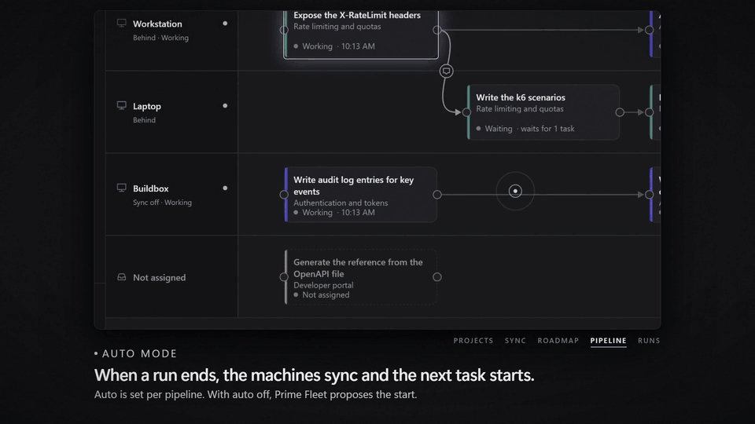

# Prime Agent Studio Fleet

[English](README.md) · **Français**

> **Projet en cours · démo technique.** Ce projet montre comment piloter plusieurs [Prime Agent Studio](https://github.com/zerr0o/prime-agent-studio) avec l’API publique v1 de Studio. Ce n’est pas un produit fini : attendez-vous à des manques et à des changements incompatibles.

Prime Agent Studio Fleet (l’application s’appelle **Prime Fleet**) est un centre de contrôle pour plusieurs [Prime Agent Studio](https://github.com/zerr0o/prime-agent-studio). Il parle à chaque Studio par son API publique v1, regroupe les machines par projet, indique si chaque machine a une Roadmap à jour et exécute un pipeline prévisionnel de tâches de la Roadmap sur vos PC.

C’est une application React Native (Expo SDK 57) pour **Android** (téléphone et tablette) et le **web sur PC**, servie par un petit relais local.

[](https://github.com/zerr0o/prime-agent-studio-fleet/releases/tag/intro-video)

**Vidéo d’introduction** (45 s, avec le son, en anglais) : [télécharger le MP4](https://github.com/zerr0o/prime-agent-studio-fleet/releases/download/intro-video/prime-fleet-intro.mp4) (12 Mo) · filmée avec le simulateur intégré, données d’exemple uniquement.

## Ce qu’elle fait

- **Les projets d’abord.** Un projet présent sur plusieurs machines (même `syncId`) apparaît une seule fois, avec chaque machine et l’état de synchronisation de sa Roadmap : Synchronisée, La plus récente, En retard, Divergente, Synchro désactivée, Hors ligne.
- **La Roadmap ensuite.** Lisez la Roadmap de n’importe quelle machine, cochez ou décochez des tâches et attribuez chaque tâche (étape, plan entier ou élément du backlog) à une machine du projet.
- **Pipeline (vue nodale).** Un couloir par machine. Les tâches sont des nœuds, les liens sont des dépendances. Glissez une tâche dans un autre couloir pour la réattribuer ; tirez depuis le port droit d’une tâche vers une autre pour les lier. Chaque nœud affiche son état en direct : Prête, En file, En cours, Terminée, À vérifier, Échec, En attente, Machine hors ligne.
- **Mode auto par pipeline.** À la fin d’un run (fermeture de son flux SSE), Prime Fleet synchronise les machines du projet par Cloudflare R2, relit les Roadmaps et lance la tâche prête suivante sur sa machine. Sans le mode auto, il propose le lancement.
- **Conversation de la tâche suivante.** Dans les réglages du pipeline, choisissez une nouvelle conversation pour chaque tâche ou « Reprendre la précédente ». Ajustez-le par tâche (nouvelle conversation, sa dernière conversation, ou celle d’une tâche qu’elle attend), ou avec l’interrupteur d’un lien sélectionné ; une petite bulle marque le lien qui transmet la conversation. Prime Fleet transfère cette conversation sur la machine suivante par la synchronisation R2 de cette seule conversation avant de lancer la tâche. Si le transfert échoue, la tâche ne démarre pas : vous choisissez à nouveau, rien n’est remplacé en silence.
- **Consignes injectées.** Chaque tâche lancée par Prime Fleet demande à l’agent de cocher son étape de Roadmap une fois la tâche terminée et, par défaut, de faire `git pull` au début puis commit et push sur la branche courante à la fin. Modifiable par pipeline.
- **Runs.** Transcription en direct, questions de l’agent répondues volontairement, messages à la suite ou de réorientation, arrêt.
- **Machines.** Ajoutez un Studio avec son adresse et son jeton, testez la connexion, choisissez sa couleur. Les jetons restent sur l’appareil et ne s’affichent que sous la forme `•••• 7f2a`.

Les attributions, liens et dispositions restent dans l’application. Utilisez Préférences, Exporter / Importer pour les passer sur un autre appareil (les jetons ne sont jamais exportés).

## Prérequis

1. **Prime Agent Studio 4.3 ou plus récent** sur chaque PC, avec l’API activée (Préférences, API).
2. **Un jeton par Studio** (Préférences, API, Créer un jeton) : portées `read`, `runs:write`, `roadmaps:write`, `sync:write`, sur **tous les projets**. Une synchronisation complète couvre tous les projets synchronisés : un jeton limité à certains projets ne peut pas envoyer les Roadmaps juste après un run. Transférer une conversation vers une autre machine demande aussi `sync:write` sur les deux jetons.
3. **Synchronisation Cloudflare R2** configurée dans chaque Studio (Préférences, Synchronisation), pour qu’une étape cochée sur un PC arrive sur les autres.
4. **Adresses acceptées par Studio pour l’API** :
   - ce PC : `http://127.0.0.1:3088` ;
   - un autre PC : son adresse Tailscale HTTPS `https://nom-du-pc.tailnet.ts.net` (Studio, Préférences, Accès distant, Tailscale HTTPS) ou Tailscale HTTP `http://100.x.y.z:3089`.
   Studio refuse l’API sur le réseau local en clair (`192.168.x.x`).

## Utilisation sur PC (web)

```sh
npm install
npm run serve:web        # construit l’application web puis démarre le relais
```

Ouvrez http://127.0.0.1:8790. Le relais n’écoute que sur 127.0.0.1. Il sert l’application et transmet `/relay/api/v1/*` au Studio choisi, car Studio refuse les appels des pages web d’une autre origine.

## Utilisation sur Android

```sh
npm install
npx expo prebuild --platform android   # une fois
npm run android:apk
```

L’APK se trouve dans `android/app/build/outputs/apk/release/app-release.apk`. Installez-le avec `adb install` ou copiez-le sur le téléphone. Sur le téléphone, connectez Tailscale puis ajoutez chaque PC avec son adresse Tailscale et son jeton.

## Développement

```sh
npm run sim       # 3 Studios simulés sur les ports 3101 à 3103 (jetons dans la console)
npm run relay     # relais sur 127.0.0.1:8790 (autorise l’origine du serveur Metro)
npm run web       # serveur de développement Metro, web
npm test          # vitest : domaine, chef d’orchestre, i18n, relais, simulateur (116 tests)
npm run typecheck
```

Le simulateur implémente le contrat de l’API v1 (`docs/openapi-v1.json`) avec trois machines, des projets partagés, un bucket R2 simulé, des runs avec événements SSE, des questions de l’agent et des scénarios d’échec (`[fail]`, `[nocheck]`, `[ask]`, `[slow]` dans le texte d’une tâche). Il permet d’essayer le pipeline sans coût.

Architecture et règles : [docs/ARCHITECTURE.md](docs/ARCHITECTURE.md).

## Comment le pipeline décide

- Une tâche est **terminée** quand son étape est cochée dans une Roadmap synchronisée.
- Une tâche est **prête** quand ses dépendances sont terminées, que sa machine est en ligne et possède le projet, et qu’aucune autre tâche de ce projet ne tourne sur cette machine.
- Un run qui se termine **sans cocher son étape** met la tâche **À vérifier**. Rien ne s’enchaîne après elle tant qu’une personne ne la marque pas terminée ou ne la relance pas.
- Une tâche terminée puis **décochée** (dans Studio ou dans Prime Fleet) est **rouverte** : elle redevient ouverte (Prête, En attente…) et son prochain lancement est une nouvelle tentative. Elle ne redémarre jamais seule, même en mode auto : lancez-la depuis son nœud ou avec « Lancer les tâches prêtes ».
- Chaque tâche se lit dans la copie synchronisée qui porte la version la plus récente de son plan, comme la fusion de Studio. Une machine sans synchronisation R2 garde ses propres cases cochées, et sa copie ne masque jamais une case cochée ailleurs.
- Un run en échec ou arrêté, une réponse perdue ou une machine hors ligne ne sont **jamais relancés automatiquement**, ni déplacés vers une autre machine.
- Deux appareils qui pilotent le même pipeline ne lancent pas deux fois la même tâche : les identifiants de requête sont stables par tentative et Prime Fleet reprend un run qui existe déjà.

## Limites

- Prime Fleet orchestre tant qu’il est ouvert (page web ou application Android au premier plan).
- Studio garde les runs terminés une heure ; au-delà, ils se lisent dans l’historique de la conversation.
- La version web garde les jetons dans le stockage du navigateur de `127.0.0.1:8790`.
